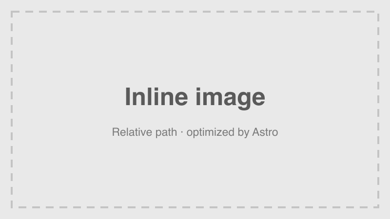

This example post shows how posts are written. It stays a **draft**, so it appears in `npm run dev` but never in production builds, RSS, or the sitemap.

## Headings

Use `##` for sections and `###` for subsections. The page title comes from the frontmatter `title`, so don't add a `#` heading.

### A subsection

Text under a subsection, with _emphasis_, **bold**, ~~strikethrough~~, and `inline code`.

## Lists

- An unordered item
- Another item
  - A nested item

1. First step
2. Second step
3. Third step

## Table

| Feature        | Supported | Notes                         |
| -------------- | :-------: | ----------------------------- |
| Tables         |    Yes    | GitHub-flavored Markdown      |
| Code blocks    |    Yes    | Syntax highlighted at build   |
| Local images   |    Yes    | Optimized by Astro            |

## Blockquote

> Good writing is clear thinking made visible.
>
> — A blockquote can span several paragraphs.

## Code block

```ts
export function greet(name: string): string {
  return `Hello, ${name}!`;
}
```

## Links

An external link: [Astro documentation](https://docs.astro.build/). A link to the main site: [Graffiti](https://mygraffiti.ai/).

## Images

Put images in the post's folder and reference them with a relative path:


