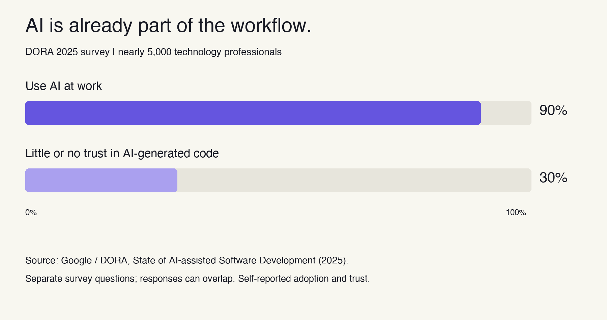
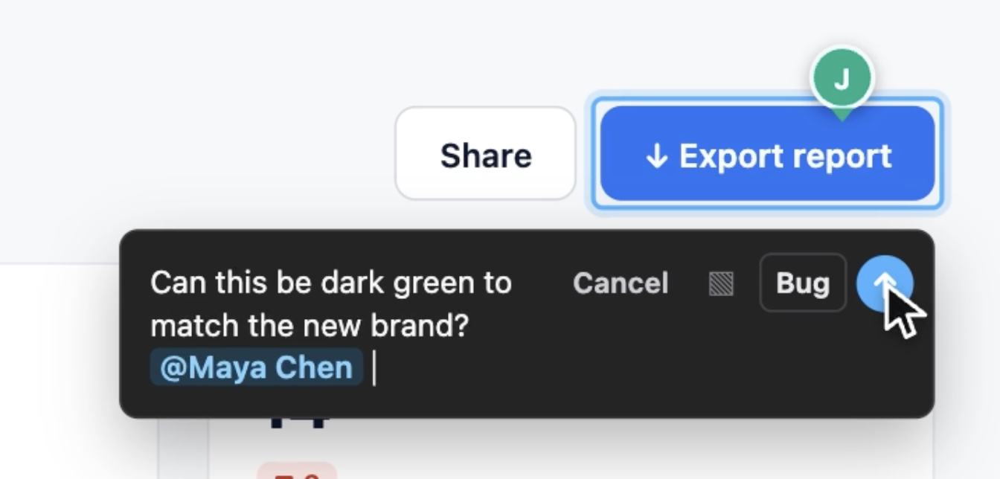
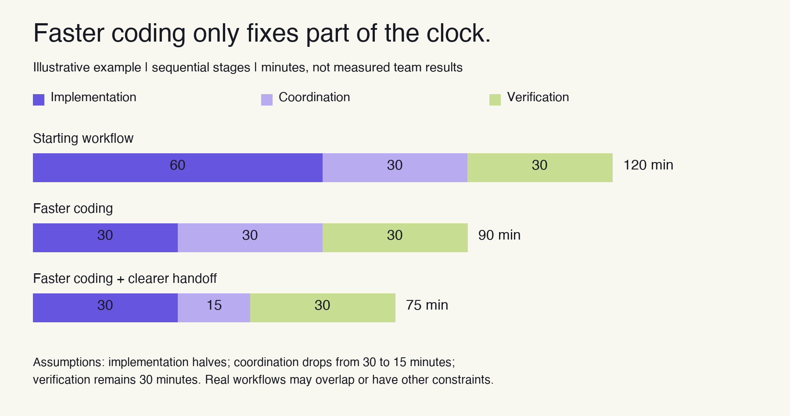

_AI can help you build faster. Someone still has to work out what needs changing._

You send the staging link.

“Last look before we launch. Any feedback?”

The designer screenshots the hero. Marketing drops copy suggestions in Slack. Someone records a Loom. The engineer asks which button everyone's talking about.

By the afternoon, there are three places to check for feedback and a message that says “looks good!” without specifying what looks good.

The page exists. Getting everyone to agree it's ready is a whole other project.

## The build got faster. The handoff needs to catch up.

AI has earned its place in development. Across three randomized field experiments involving 4,867 developers, researchers estimated **26.08% more completed tasks** among developers given access to an AI coding assistant. [1]

DORA’s 2025 survey of nearly 5,000 technology professionals found **90% used AI at work**. It also found **30% had little or no trust in AI-generated code**. [2]

_AI is widely used, and human judgment remains part of the workflow. Source: DORA 2025._

The opportunity is real. So is the work around the output.

A coding tool can help implement a change. It doesn’t settle whether the headline makes sense, whether the button takes users to the right place, or whether the latest revision answers the reviewer’s concern.

Someone still has to identify the problem, explain it, and check the result.

Our bet: as implementation gets faster, the **quality of the handoff matters more**.

## Your teammate shouldn’t have to decode the screenshot

Take this comment:

> “Can we make this clearer?”

Attached to a screenshot, it could mean the headline, the paragraph, the button, or the layout. The reviewer is thinking about positioning. The engineer might start changing font size.

Now put the feedback directly on the element:

There’s a clear subject, its location, a comment, an owner, an outcome waiting for a defined action.

The difference is practical. Your teammate can start considering the change instead of asking what the comment refers to and where it is.

Otherwise, somebody becomes the human search engine for the launch: finding screenshots, linking threads, explaining decisions, and chasing updates.

Important work, but hours or even days can be lost getting alignment.

## Look at the whole clock

Consider a simple sequential workflow: 60 minutes implementing, 30 coordinating, and 30 verifying.

Cut implementation in half and the total falls from 120 to 90 minutes. Cut coordination from 30 to 15 minutes as well, and it falls to 75. Verification gets the same time throughout.

_Illustrative model with assumed timings. It shows how the stages add up, rather than forecasting a team’s results._

That’s why “the code is done” doesn’t tell you when the page will ship.

The time spent figuring out what to change, who is taking it, and whether it worked belongs on the clock too.

## Keep the conversation where the change happens

We’re building Graffiti for teams reviewing landing pages, staging builds, and web apps.

The idea is straightforward: leave feedback on the page, discuss it in context, give the change an owner, and resolve it after checking the result.

_Above: Graffiti design preview on a fictional example site._

When someone returns to the page, they should be able to see what still needs attention and pick up the reasoning behind it.

A better review gives the next person enough context to act. That matters whether they make the change themselves or use a coding agent to help.

Graffiti is now available on the [Chrome Web Store](https://chromewebstore.google.com/detail/graffiti/pkebecmhcgfkgndfpnfghpmghbigaooi).

**Have a page launching soon? [Bring it to a review session with us](https://mygraffiti.ai/).** We’d like to see where your feedback gets stuck and help you work through the next review in Graffiti.

### Sources

[1] [Cui et al., June 2025](https://www.microsoft.com/en-us/research/publication/the-effects-of-generative-ai-on-high-skilled-work-evidence-from-three-field-experiments-with-software-developers/). Pooled estimate across three randomized field experiments; standard error 10.3 percentage points. Completed tasks measure output, not an equivalent reduction in delivery time.

[2] [Google’s summary of DORA 2025](https://blog.google/innovation-and-ai/technology/developers-tools/dora-report-2025/). Adoption and trust are self-reported responses to separate questions; groups can overlap. The report also associates AI adoption with higher delivery throughput. These studies establish the development context; Graffiti’s impact requires its own measurement.
